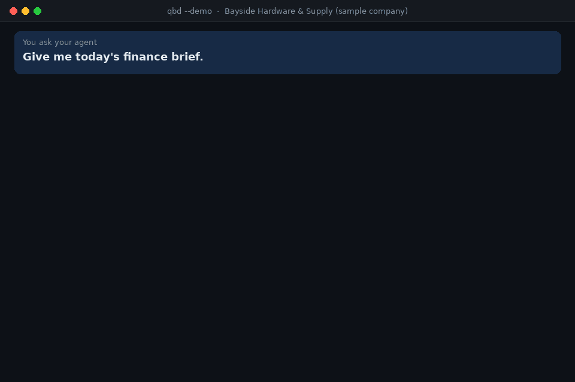
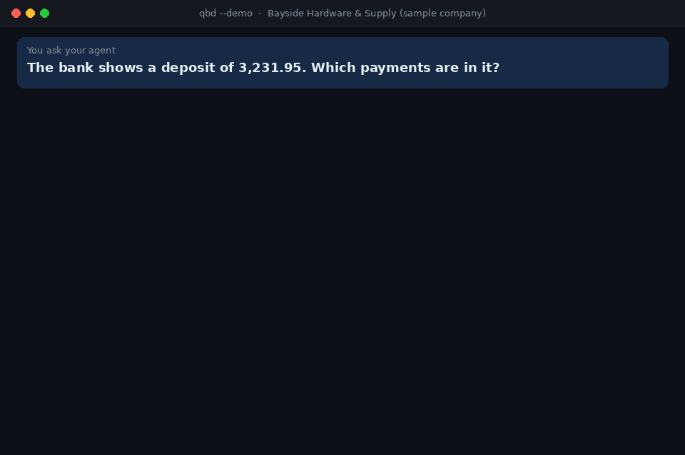
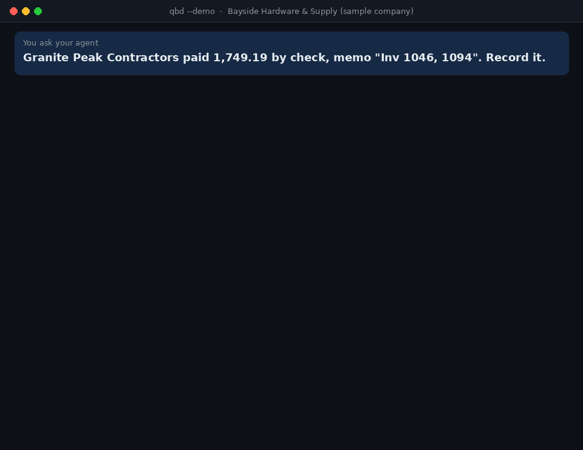
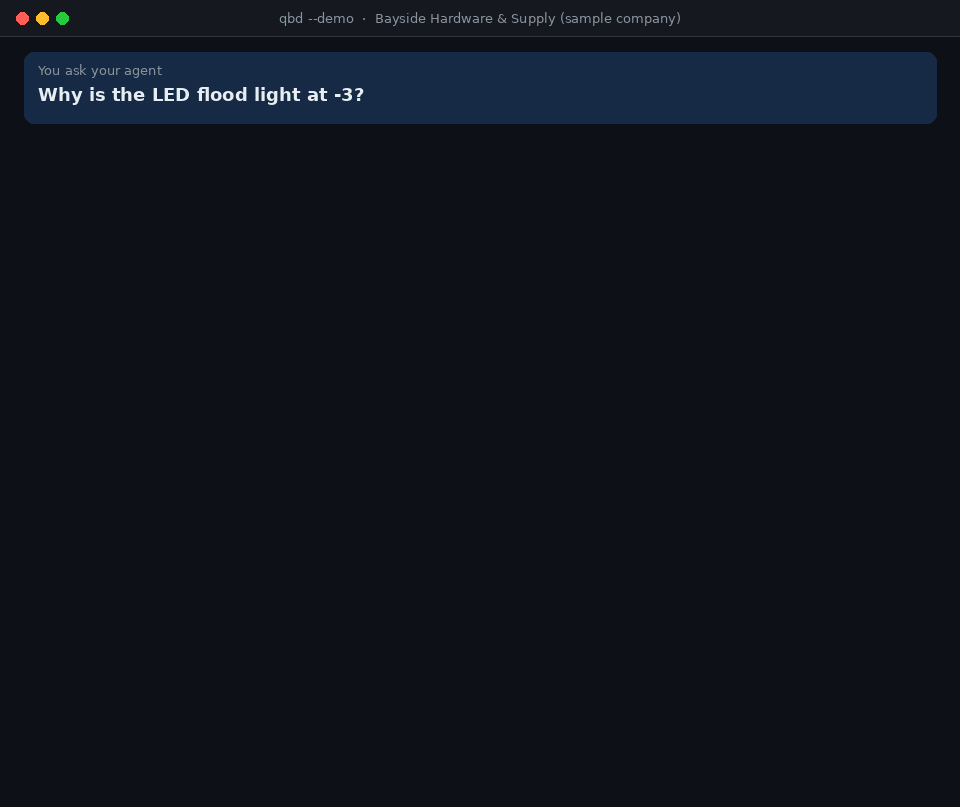
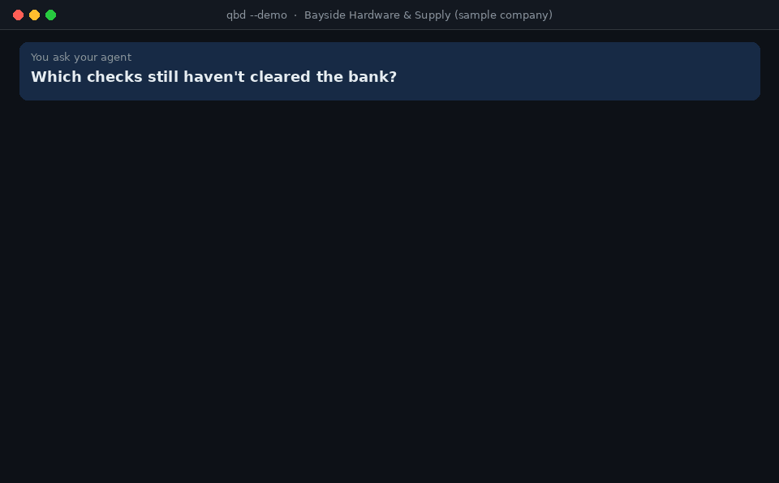

<div align="center">


# Agent Kit for QuickBooks Desktop

**Let an AI agent do the bookkeeping legwork in QuickBooks Desktop, from the Windows PC that already runs it.**

`qbd` is a command line made for AI agents. Workflow commands do the multi-step jobs of an owner, bookkeeper or
buyer; record commands reach any list, transaction or report; changes are saved only after a person approves them.
Every command prints one line of JSON.

[](https://github.com/ph4mHoa/qbd-agent-kit/actions/workflows/ci.yml)
[](LICENSE)

[Setup](docs/setup.md) · [Commands](docs/commands.md) · [Skills](skills) · [Safety](docs/safety.md) ·
[Troubleshooting](docs/troubleshooting.md) · [Compared with other options](docs/comparison.md)



</div>

Read-only until you turn changes on. A change is checked, previewed, saved only after a person says yes, logged, and
can be undone. Every animation on this page is the real output of `qbd --demo`, the built-in sample company.

## Problems it solves

### "Which payments make up this bank deposit?"

The bank shows one deposit of 3,231.95 and Undeposited Funds holds eight payments. `qbd deposits` finds the ones
that add up to it, ready to record as one deposit.



### "A customer paid two invoices with one check."

`qbd match-payment` reads the memo and the open invoices. The payment is then drafted, shown to you, and saved only
after your yes.



### "Why is this item below zero?"

Negative stock makes the cost of goods sold wrong. `qbd stock-history` finds each sale that took the item below
zero and the purchase that brought it back, with the fix.



### "Are the books ready to close the month?"

`qbd health-check` runs the checks an accountant runs before closing: uncategorized amounts, undeposited payments,
late invoices, unapplied credits, negative stock and dates typed wrong, each with its fix.


### "Which checks never cleared the bank?"

`qbd uncleared` lists bank items that never cleared, oldest first, and the ones stuck in a reconciliation that was
never finished.



## What you can ask

| Ask | The agent runs | What comes back |
| --- | --- | --- |
| *"Give me today's finance brief."* | `qbd daily-brief` | Cash, money owed and how late, bills due soon, sales against last month, low stock, and what needs attention today |
| *"Who should I chase for payment?"* | `qbd receivables` | Customers most overdue first, with contacts, days late, a suggested reminder step, and unapplied payments to apply first |
| *"Foxhall paid 1,200 by check. Which invoices is that for?"* | `qbd match-payment` | The open invoices it most likely pays, how sure that is, and the payment ready to draft |
| *"The bank shows a deposit of 3,231.95. What's in it?"* | `qbd deposits` | The payments waiting in Undeposited Funds that make it up, card batches less a fee included |
| *"How far along is sales order SO-881?"* | `qbd trace` | The chain from estimate or order to invoices, payments and the bank deposit (or from purchase order to receipts, bills and bill payments), with what is still open |
| *"What bills are due, and can we afford them?"* | `qbd payables`, `qbd cash-position` | A payment run checked against a week-by-week cash estimate |
| *"Which purchase orders should I chase?"* | `qbd purchasing` | Late order lines, goods received but never billed, and bills that differ from their order in cost or quantity |
| *"What should I reorder from Metro Electric?"* | `qbd reorder`, `qbd stock`, `qbd backorders` | Quantities from reorder points, stock on order and sales speed, and which open orders can ship now |
| *"Why is the LED flood light at -3?"* | `qbd stock-history` | Each time the item went below zero this year, the sale that took it there and the purchase that brought it back, with the fix |
| *"The reconciliation's beginning balance is 200 off the bank statement. Why?"* | `qbd reconcile-check` | What QuickBooks counts as reconciled against the bank's balance, and the reconciled transactions changed, voided or deleted since |
| *"Are we selling below our price list?"* | `qbd price-check` | Invoice and sales receipt lines priced under the item list or the customer's price level, what that cost, by customer, item and sales rep |
| *"Why doesn't the sales tax we owe match the balance sheet?"* | `qbd sales-tax-check` | What the Sales Tax Liability report says is owed against Sales Tax Payable on the balance sheet, and the sales tax paid by check, bill or card instead of Pay Sales Tax |
| *"What are our foreign-currency balances worth at today's rate?"* | `qbd currency` | Each foreign account in its currency, what the books carry it at and the gain or loss at the rate; customers and vendors paid in full that still carry a home-currency balance; transactions entered at a rate of 1 or upside down |
| *"Who gets a 1099 for 2026?"* | `qbd 1099` | Vendors over the year's IRS threshold, missing tax IDs and addresses, and vendors paid enough but not marked for 1099 |
| *"Check the books before I close September."* | `qbd health-check`, `qbd uncleared`, `qbd find-duplicates` | Uncategorized amounts, undeposited payments, duplicates, negative stock and old uncleared checks, each with its fix |
| *"Why was profit lower last month?"* | `qbd compare-periods` | Two periods side by side, the lines that changed most first |
| *"Enter this bill."* (with a PDF) | `qbd coding`, `qbd draft add bill` | The vendor's usual accounts, then a checked draft and a preview, saved only after you say yes |
| *"Import these 40 invoices from the spreadsheet."* | `qbd import invoice` | Every row checked, one preview, saved after one approval; rows saved before are skipped |
| *"Top 10 customers this year?"* | `qbd report sales_by_customer` | QuickBooks' own report, so the totals match QuickBooks |
| *"I'm about to rebuild the company file. Will anything change?"* | `qbd snapshot` | Every account's balance and the count of each record type, saved before and compared after, with what moved |
| *"The store sync stopped last night. Why?"* | `qbd web-connector` | Each app that syncs through the QuickBooks Web Connector: when it last ran, its last error, what that error means and the fix |

## Why this kit

- **Runs where QuickBooks runs.** It talks to QuickBooks through the SDK that QuickBooks installs on the same PC.
  No Web Connector, no cloud service in between, no fee per company file.
- **A command line, not a server.** Each command connects, answers in one line of JSON and exits, so nothing keeps
  running between commands. Any agent that can run a command can use it: Claude Code, Codex, Cursor or a script.
- **Workflows, not just records.** Twenty-two workflow commands do the multi-step jobs and return figures plus the
  next step. Eleven record commands cover everything else.
- **Safe by default.** Read-only until the owner turns changes on. A change is checked (closing date, amount limit,
  names that exist, text too long for its field, duplicates, lines that would be dropped, a document entered before), previewed with what
  QuickBooks will fill in, saved with a one-time token after a person approves, logged, and can be undone.
- **Try it in two minutes.** A built-in sample company with planted problems runs on any computer.

## Quick start

On the Windows PC with QuickBooks Desktop, with [Python](https://www.python.org/downloads/windows/) 3.10 or newer:

```
py -m pip install https://github.com/ph4mHoa/qbd-agent-kit/archive/refs/heads/main.zip
qbd authorize
qbd doctor
qbd daily-brief --pretty
```

No Python on that PC? The Windows download in [Releases](https://github.com/ph4mHoa/qbd-agent-kit/releases/latest)
has Python, pywin32 and the kit in one folder: unzip it to `C:\qbd` and run `C:\qbd\qbd.cmd` where this page says
`qbd`.

`qbd authorize` needs QuickBooks open with the company file, logged in as Admin. QuickBooks asks whether to let
*QBD Agent Kit* in: choose **Yes, whenever my QuickBooks company file is open**
([details](docs/setup.md#3-give-quickbooks-permission)).

Then give your agent the commands:

- **Claude Code:** `claude plugin marketplace add ph4mHoa/qbd-agent-kit`, then
  `claude plugin install qbd-agent-kit@qbd-agent-kit`, adds the [skills](#whats-inside).
- **Any other agent:** tell it to run `qbd help` first; `qbd help <command>` explains each command.

No QuickBooks at hand? The sample company works on any computer with Python:

```
pip install https://github.com/ph4mHoa/qbd-agent-kit/archive/refs/heads/main.zip
qbd daily-brief --demo --pretty
```

## What's inside

**42 commands** ([reference](docs/commands.md)); `qbd help <command>` prints the same text.

- Workflows: `daily-brief`, `trace`, `receivables`, `match-payment`, `deposits`, `payables`, `coding`,
  `cash-position`, `reorder`, `stock`, `backorders`, `purchasing`, `stock-history`, `1099`, `uncleared`,
  `reconcile-check`, `price-check`, `sales-tax-check`, `currency`, `find-duplicates`, `health-check`, `compare-periods`
- Records: `status`, `profile`, `search`, `export` (to CSV), `count`, `changes`, `snapshot`, `get`, `report`
  (35 named reports and any other report type), `schema`, `raw` (any qbXML query)
- The QuickBooks PC: `file-health`, `web-connector`
- Changes, only when turned on: `draft`, `import` (from CSV), `commit`, `undo`, `log`
- Setup: `doctor`, `authorize`

**9 agent skills** ([skills/](skills)), plain `SKILL.md` files that teach the agent each routine:

| Skill | For |
| --- | --- |
| [quickbooks-desktop](skills/quickbooks-desktop/SKILL.md) | The basics: which command to use, bounded requests, the draft and approve rules |
| [daily-finance-brief](skills/daily-finance-brief/SKILL.md) | A short morning summary with today's actions |
| [ar-collections](skills/ar-collections/SKILL.md) | Who to chase, and reminder emails by stage |
| [bills-and-cash](skills/bills-and-cash/SKILL.md) | A payment run checked against cash |
| [month-end-check](skills/month-end-check/SKILL.md) | What to fix before closing a month |
| [inventory-reorder](skills/inventory-reorder/SKILL.md) | Reorder quantities and purchase orders per vendor |
| [ask-the-books](skills/ask-the-books/SKILL.md) | Picking the right report for any question |
| [enter-bill-from-document](skills/enter-bill-from-document/SKILL.md) | A vendor invoice into a bill, checked and approved |
| [support-case](skills/support-case/SKILL.md) | What is wrong with QuickBooks, the file or a sync app, who fixes it, and the note to send them |

## How it works

```
AI agent (Claude Code, Codex, Cursor, a script...)
   │  runs qbd <command>, reads one line of JSON
   ▼
qbd (Python): commands, checks, drafts, write log, personal-data masking
   │  COM: QBXMLRP2.RequestProcessor, through pywin32
   ▼
QuickBooks SDK  ──►  QuickBooks Desktop and the company file
```

Requests are built from the qbXML 16.0 schema, so elements always go in the order QuickBooks requires, and `qbd`
uses the newest qbXML version QuickBooks supports, up to 16.0. QuickBooks answers one request at a time, so commands
take turns. Nothing leaves the PC except what the AI app itself sends to its model; see
[where your data goes](docs/setup.md#where-your-data-goes).

## Settings

Settings are environment variables, and all are optional. The ones most people need:

| Setting | Default | What it does |
| --- | --- | --- |
| `QBD_ALLOW_WRITES` | `false` | Turns on `draft`, `import`, `commit`, `undo` and `log` |
| `QBD_ALLOW_DELETE` | `false` | Also allows deleting and voiding |
| `QBD_WRITE_ENTITIES` | customers, vendors, invoices, estimates, sales orders, sales receipts, credit memos, customer payments, bills, purchase orders | The record types that may change |
| `QBD_MAX_AMOUNT` | `10000` | A change whose total is above this is refused; the total counts the prices QuickBooks fills in |
| `QBD_COMPANY_FILE` | the file open in QuickBooks | Pins every command to one company file |

The full list is in [setup](docs/setup.md#settings). These settings prevent mistakes, but an agent that can run any
command can also change them; [safety](docs/safety.md#settings-are-not-a-lock) explains what actually holds.

## Status

Version 0.2.0, an early release, not on PyPI yet.

- Automated tests run every command, check and the change flow against the sample company, on Python 3.10 and 3.15.
- Run on Windows 10 with QuickBooks Enterprise 24, Canadian edition with multicurrency (qbXML 16.0), and a
  multi-gigabyte company file:

  | Area | Run there |
  | --- | --- |
  | Records and setup | `doctor`, `status`, `search`, `get`, `count`, `changes`, `snapshot`, `report`, `raw`, `schema`, `file-health`, `web-connector` |
  | Workflows | `daily-brief`, `receivables`, `payables`, `cash-position`, `reorder`, `stock`, `stock-history`, `uncleared`, `reconcile-check`, `price-check`, `sales-tax-check`, `currency`, `find-duplicates`, `health-check`, `compare-periods` |
  | Changes, on test records | `draft`, `commit`, `undo`, `import` and `log`: a customer, a service item and invoices added; a token used twice and a source entered twice refused; a CSV import run twice, the second time skipped; every record undone |

  Each command used about 75 MB of memory at its peak; the slowest, `health-check`, took about 35 seconds.
- Tested only on the sample company so far: `trace`, `match-payment`, `deposits`, `coding`, `backorders`,
  `purchasing`, `1099` (US only), `profile` and `export`.

Report layouts can differ between QuickBooks editions, versions and countries. Please
[open an issue](https://github.com/ph4mHoa/qbd-agent-kit/issues) if a command misreads yours.

## Development

```
python -m pip install -e .
python -m unittest discover -s tests
python scripts/gen-docs.py      # rewrite docs/commands.md after changing a command
python scripts/make-demo-gifs.py  # render assets/*.gif from the sample company (needs Pillow)
qbd health-check --demo --pretty
```

`python scripts/build-windows-zip.py <python embeddable zip> <pywin32 wheel>` builds the Windows download: one
folder with Python, pywin32 and the kit, started with `qbd.cmd`, so nothing has to be installed on the QuickBooks
PC. The script's header says which files to download.

| Path | What |
| --- | --- |
| `src/qbd_agent_kit/cli.py` | The command line: arguments, help, errors, `doctor` and `authorize` |
| `src/qbd_agent_kit/bridge/` | The COM connection to the QuickBooks SDK |
| `src/qbd_agent_kit/qbxml/` | qbXML builder and parser; the schema is generated from the SDK's XSD |
| `src/qbd_agent_kit/qb/` | QuickBooks client, record catalog, dates |
| `src/qbd_agent_kit/tools/` | The commands |
| `src/qbd_agent_kit/safety/` | Write log and personal-data masking |
| `src/qbd_agent_kit/demo/` | The sample company |
| `skills/` | Agent skills |

Contributions are welcome: bug reports with `qbd doctor` output, report layouts from other QuickBooks editions and
countries, and new workflows. Please never attach real company data.

## License

[MIT](LICENSE). QuickBooks is a trademark of Intuit Inc. This project is not affiliated with or endorsed by Intuit.
